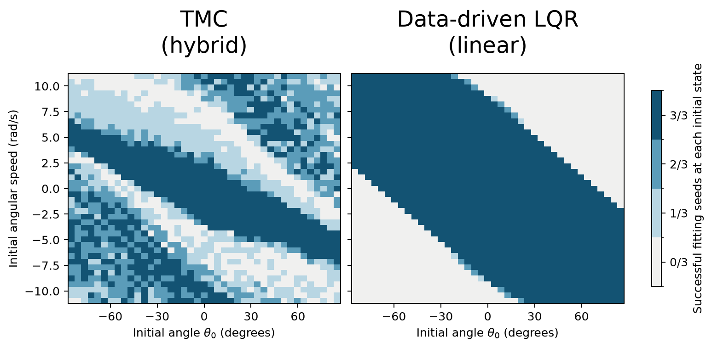
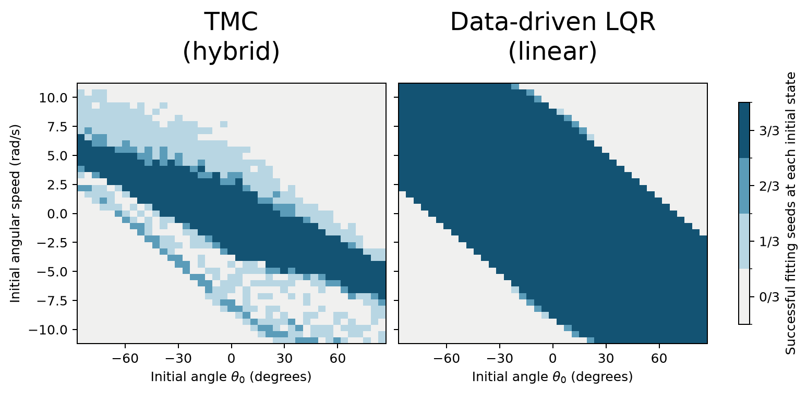

# Reproduce the original convergence-region figure

The supplied screenshot matches **terminal recovery**, allowing earlier horizontal
crossings. The original campaign also reported the stricter **primary success**
endpoint, which forbids those crossings. Comparing only primary-success maps does
not reproduce the screenshot's hybrid pattern.

The upstream experiment was checked at
[`053b14890a107063db9b58859884f655173528b8`](https://github.com/aroyphillips/TrajectoryManifoldControl/tree/053b14890a107063db9b58859884f655173528b8).
The campaign code is byte-identical to this repository's pinned migrated copy.
Sources: [grid and metrics](https://github.com/aroyphillips/TrajectoryManifoldControl/blob/053b14890a107063db9b58859884f655173528b8/validation/experiments/campaign.py),
[original regime plots](https://github.com/aroyphillips/TrajectoryManifoldControl/blob/053b14890a107063db9b58859884f655173528b8/validation/experiments/briefing_regime_figures.py),
[explicit endpoint comparison](https://github.com/aroyphillips/TrajectoryManifoldControl/blob/053b14890a107063db9b58859884f655173528b8/validation/experiments/literature/plot_endpoint_sensitivity.py).

The figure's data contract is:

- 41 equally spaced angles from −85° to +85° and 41 equally spaced normalized
  angular rates from −3.5 to +3.5. Physical rate is normalized rate × √9.81,
  giving approximately ±10.96 rad/s. The axes show cell centers plus half-cell
  margins; no interpolation or smoothing.
- Initial cart position and velocity are exactly zero. Each arm uses the same
  1,681 saved D states and seeds 0, 1, 2: 10,086 rollouts in total.
- Each rollout lasts 14 physical seconds at 20 ms/sample (700 actions).
- Terminal recovery requires all states/inputs finite and, on **every sample in
  the final three seconds**, |θ| ≤ 0.02 rad and |θ̇| ≤ 0.05 physical rad/s.
  Earlier crossings are allowed; the continuous angle is not wrapped. Cart
  rest/recentering is not required. Failed/short traces do not count as successes.
- Primary success additionally requires |θ| < π/2 throughout the rollout.
- H is the **original hybrid**, not current standalone Adam TMC: CEM256/32/3,
  horizon30, replan5, switch xᵀQx<0.75, original zero action on invalid plans.
  L uses clipped −Kx with K fitted from the same seed's training split.
- Color counts successful **fitting/planning seeds**, 0/3 through 3/3. Missing
  seed coverage is gray, distinct from zero successes. This is finite-time
  empirical coverage, not a certified basin or probability estimate.

## Verified reproduction from archived data

The screenshot-format reconstruction from all original archived cases is below.
The same colors, seed-count scale, panel labels, grid, axes and units are used.
Typography/spacing follow a new Matplotlib rendering, rather than a pixel copy.



Terminal recovery: H **2,864/5,043**, L **3,247/5,043**.
For comparison, the original stricter no-crossing map is:



Primary success: H **1,485/5,043**, L **3,247/5,043**.
[Provenance and hashes](provenance.json), [terminal counts](archived_terminal_counts.npz)
and [primary counts](archived_primary_counts.npz) preserve the verified data.
These are archived outcomes, not newly simulated training reconstructions.

## Launch a new simulation sweep

Run from the repository root in the project environment. First prepare all three
matched model/data pairs; the existing seed-0 pair is reused. This can take hours.
The reconstruction is a fresh experiment using the original recipe, not an exact
replay of original unavailable trained weights. Numerical libraries/hardware can
also change newly generated outcomes.

```sh
micromamba activate control311
for seed in 0 1 2; do
  python scripts/validation_benchmark.py --train --seed "$seed" --device cpu \
    --model-dir "saves/validation/models/reconstructed-seed${seed}" \
    --output "saves/validation/grid-training-seed${seed}" \
    --arms L --set A --limit 1 --seconds .04 || break
done
```

Each training job collects 3,500 episodes and trains 100 epochs if artifacts are
missing. The `.04` limits only its subsequent L rollout. Training has no wall
budget. Keep each `transition.pt` with its own `data.npz`.

Run a quick pipeline check (not a scientific map):

```sh
python scripts/sweep_tmc.py --seeds 0 --limit 1 --seconds .04 \
  --output saves/validation/grid-smoke-v2 --max-wall-seconds 60
```

Launch the full original-hybrid versus linear sweep:

```sh
python scripts/sweep_tmc.py \
  --models-root saves/validation/models --seeds 0 1 2 \
  --controller legacy-hybrid --seconds 14 \
  --output saves/validation/grid-hybrid-3seed-v1 \
  --max-wall-seconds 172800
```

The 48-hour per-invocation budget is checked between cases. A tested extreme
seed-0 H case took about 16 s on this CPU; 5,043 H cases alone could take about
22 hours at that rate, with substantial variation by initial state/hardware.
No compute delay is injected into the simulated plant.

Repeat the **same** full command to resume. Saved raw hashes are checked and
completed cases skipped. `--limit` and the budget may change on resume; the grid,
seed list, controller, duration, artifacts, sources and library versions may not.
The smoke uses a different duration/output and cannot resume as the full run.
Use a new output for changed protocols. Run only one writer per output directory.
`--train` on the sweep command is an optional shortcut to prepare missing models
before sweeping; its training stage is outside the rollout wall budget.

Each invocation automatically writes:

- `initial_state_regimes.png` and `.pdf`: requested terminal-recovery figure.
- `initial_state_regimes_no_crossing.png` and `.pdf`: stricter primary endpoint.
- `grid_counts.npz` / `grid_counts_no_crossing.npz`: axes, arms, seeds, successes
  and tested seed counts per cell.
- `summary.json` / `summary_no_crossing.json`: coverage, counts, endpoint and
  completion. Full three-seed completion is `complete: true`, `saved: 10086`.
- `manifest.json`, per-seed/arm/state `cases/*.json`, and `raw/*.npz` traces and
  controller latencies. Failed solves/states are explicit in case records.

Regenerate both figures from saved sweep cases at any time:

```sh
python scripts/sweep_tmc.py \
  --output saves/validation/grid-hybrid-3seed-v1 --plot-only
```

For **current standalone TMC** on the identical grid and convergence rules, use
`--controller standalone` and a separate output such as
`saves/validation/grid-standalone-3seed-v1`. This uses Adam20/.15/3starts/replan1
with no substitute actions. Its panel says “standalone”; its outcomes are not
expected to reproduce the historical hybrid's colors.

## Rebuild directly from the original archived outcomes

To recover the same data/color counts without retraining or running controllers:

```sh
git clone --depth 1 https://github.com/aroyphillips/TrajectoryManifoldControl.git \
  /tmp/tmc-figure-upstream
git -C /tmp/tmc-figure-upstream checkout 053b14890a107063db9b58859884f655173528b8
python scripts/plot_legacy_grid.py \
  --summary /tmp/tmc-figure-upstream/validation/results_v1/E1/summary.csv \
  --output saves/validation/grid-original-archive-v1
```

The archive importer requires a new output directory and all 10,086 original
seed/arm/state records. Use `--endpoint primary_success` and another output to
rebuild the stricter map. If the shallow clone no longer contains the pinned
commit, fetch that commit before checkout. This archive workflow and new
simulation workflows are deliberately stored in separate directories.
