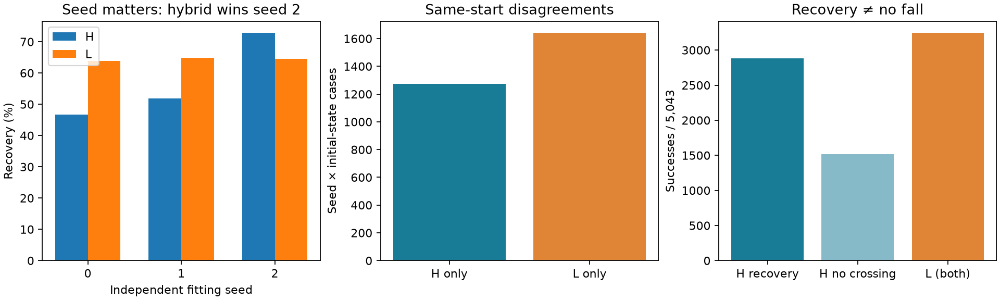
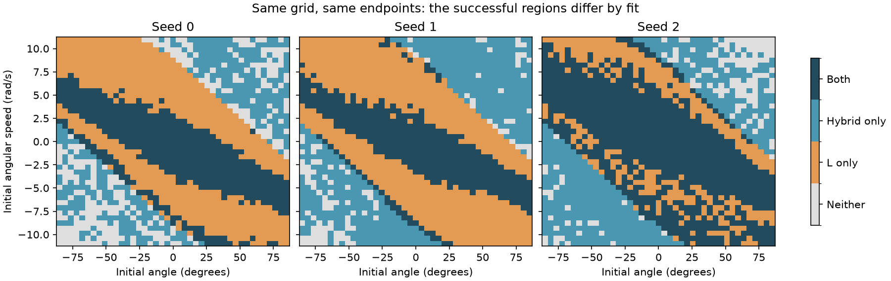
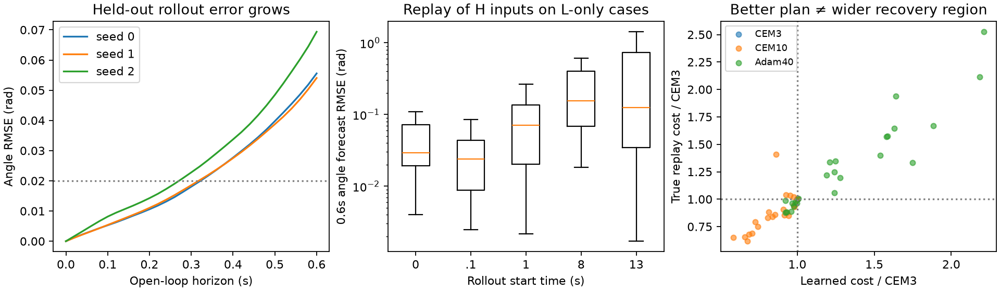
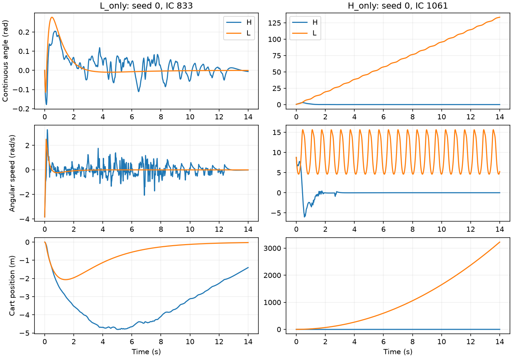

# Why the hybrid trails linear — measured investigation

**The aggregate gap is real, but it is not universal.** On all 10,086 completed
rollouts, hybrid recovered **57.1%** versus linear **64.4%**. Seed 2 reverses that:
**72.9% versus 64.5%**. The same architecture therefore can beat L on this grid;
“the network is too small” is not an established explanation.

H means the **original CEM hybrid**, not standalone Adam TMC. There were no recorded
controller failures or nonfinite CEM losses. H succeeded where L failed in 1,275
seed/state cases; L alone succeeded in 1,642. These are complementary regions,
not a uniformly worse controller. Their union is an oracle diagnostic, not an
implementable policy that knows which controller will succeed.

## What are the “three conditions” in the colors?

They are **three fitting/planning seeds: 0, 1, 2**, not three initial conditions or
three convergence definitions. Each seed changes collected episodes, network
initialization, data split, fitted linear gain and CEM randomness. The recipe is
the same. Each angle/rate grid cell is tested once per seed; colors show **0/3,
1/3, 2/3 or 3/3** successes. Cart position/velocity start at zero in all cells.

A successful screenshot rollout must have **finite states/inputs**, **|θ|≤0.02 rad**
and **|θ̇|≤0.05 rad/s throughout the final three seconds** of a 14-second rollout.
Earlier horizontal crossings are allowed. The separate “no crossing” map also
requires |θ|<π/2 throughout. Neither endpoint requires cart recentering.

## Most likely contributors

| Finding | What it supports — and what it does not prove |
| --- | --- |
| One-step angle RMSE is 0.0012–0.0015 rad, but 0.6-second endpoint angle RMSE is 0.054–0.069 rad. | Accurate one-step ID is insufficient for MPC. Error accumulation is a stronger lead than blanket undercapacity. The 0.02-rad endpoint tolerance is a scale reference, not the same statistic. |
| On sampled L-only cases, median 0.6-second angle forecast RMSE is 0.029 rad initially and 0.156 rad at t=8 s. | Model error persists along problematic hybrid trajectories. Later error may be a consequence as well as a cause of leaving the training distribution. |
| CEM10 lowers median true replay cost by 13.1% versus CEM3 on 24 tuning seed/start pairs. Adam40 raises it by 23.3%. | Original three-round search is a limitation. These are cold-start, fixed-input 0.6-second probes, not recovery-coverage results. |
| H queues five actions (100 ms); L gets state feedback every 20 ms. H optimizes a 0.6-second quadratic objective, not the 14-second success indicator. | Feedback cadence and objective/horizon mismatch are plausible contributors; neither is causally isolated by the completed grid. Longer horizons can amplify the measured model error. |

On **two tuning starts separate from the dense grid** (the established tuning set), newly run
closed-loop screens gave **H 1/2, L 2/2** for CEM3/queue5, CEM10/queue5 and
Adam20/replan1. More search alone did not fix these cases. The CEM pair changes
only search rounds; the Adam comparison changes solver and feedback cadence.

Left: L settles while H repeatedly oscillates. Right: H catches a start where L
rotates and drives the cart away. These are deterministic median-index witnesses
from seed-0 disagreement groups, not representative failure-rate estimates.
L's true local closed-loop spectral radii are approximately 0.9926, 0.9993 and
1.00003: finite 14-second angular success is not a stability certificate.

## Parameters to try next

**No supported hyperparameter set can “almost surely” beat L.** The already observed
winning seed-2 fit uses the original **3,500 episodes, 192×192×192 network,
100 epochs, CEM256/elite32/3 rounds, horizon30, replan5**: 1,225 versus 1,085
recoveries. Repeating those saved weights reproduces a measured result; selecting
seed2 after seeing this grid is post hoc selection, not independent validation.

My next candidate is **14,000 episodes; 256×256×256; 200 epochs; then 20 multistep
fine-tuning epochs with window10**. Broaden initial angles to ±85° and devote 25%
of collection to the upright neighborhood with small inputs. Screen **CEM256/32,
10 rounds, replan1 versus replan5** on tuning starts first. Keep horizon30,
Q=diag(.02,30,100,10), R=.03 and terminal12Q initially. This is a testable proposal,
not a demonstrated winner. Increasing capacity alone could worsen long-horizon
behavior; compare one-step and multistep candidates and refit L on the same data.

**[Runnable launch codes](LAUNCH.md)** cover the investigation, tuning, candidate
training, matched grid confirmation and the existing seed-2 repeat. All three
small tuning screens finished. Large candidate training and new full grids were
not launched; expect hours of training and potentially days for CEM10/replan1
across the full grid. A tiny changed-width training/fine-tuning/evaluation pipeline
was verified, including resume/protocol guards.

Evidence: [full audit and probe measurements](investigation.json),
[screen manifests and case outcomes](tuning_screens.json),
[actual launched commands](launch_records.json).
The audit verifies each model/data hash against the completed grid manifest.
Rollouts use ideal feedback; compute latency is measured, not injected. Probe
median solve times were about 90 ms (CEM3), 293 ms (CEM10), 467 ms (Adam40), all
above the plant's 20-ms sample interval. No new coverage improvement is claimed.
