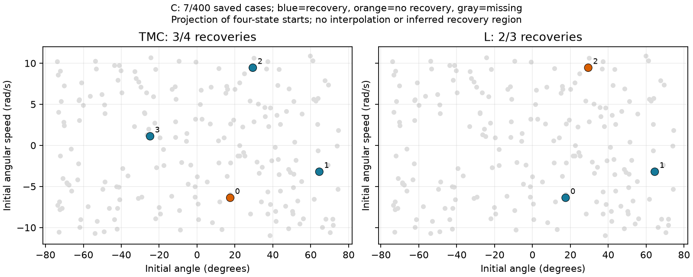
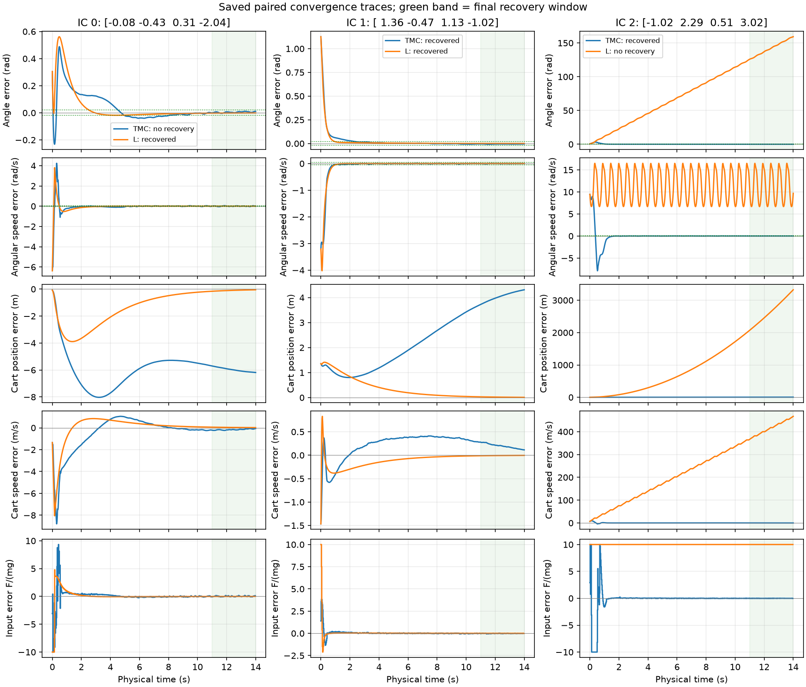
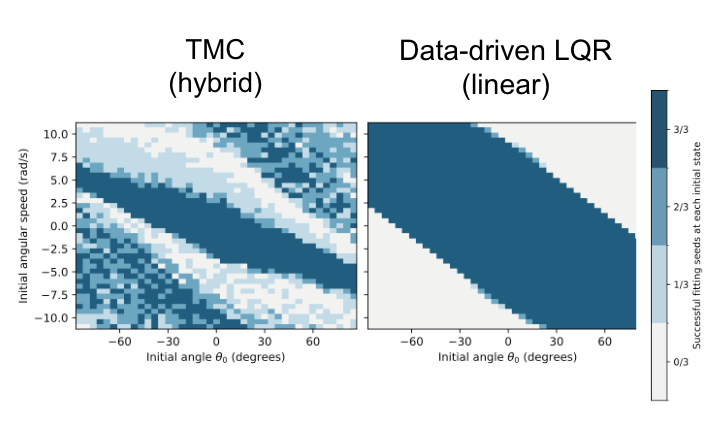

# TMC versus linear validation report

Run: `/home/ab126/projects/TrajectoryManifoldControl/saves/validation/tmc-c200-seed0-v1`. State set **C**, 14 s, training seed 0.

**Partial run: 7/400 cases saved.**

Gain source: `fitted_training_data`. Solver: `{'solver': 'adam', 'replan_interval': 1, 'periodic': False, 'terminal_window': 1, 'include_previous_input': False, 'iterations': 20, 'learning_rate': 0.15, 'starts': 3, 'population': 256, 'elite': 32, 'cem_iterations': 3, 'seed': 0}`.

| Arm | Saved | Recovered | Controller failures | Median case median latency (ms) |
| --- | ---: | ---: | ---: | ---: |
| TMC | 4 | 3 | 0 | 232.680 |
| L | 3 | 2 | 0 | 0.014 |

Paired starts: 3; TMC-only recoveries: 1; L-only recoveries: 1.

Points show saved outcomes only. The angle/rate projection does not fix cart position or velocity. Missing cases are not failures. Unequal arm counts must not be compared as a paired success rate.

## Convergence across shared initial conditions

Recovery requires continuous angle error ≤0.02 rad and physical angular speed error ≤0.05 rad/s throughout the final three seconds. It does not certify cart regulation. Solver latency is measured but not injected as feedback delay; the deadline is 20 ms. These results do not establish superiority across the full initial-condition set.

## Provenance

Checkpoint SHA256: `c3f6032f5e35b6bb36395a4eec23813ac41e44a4c72a04037b03629f5cbf4b4f`.

Manifest SHA256: `06b66da84290ef2ecc3807d62e4abbcdc9bfa9424155780cadaa621a4f566567`.

Generated from saved case JSON and raw NPZ traces, without controller reruns.

## Historical reference supplied by the user

The screenshot labels TMC as hybrid and shows successes out of three seeds. It is historical context, not a figure generated by this standalone TMC run. Its underlying data and exact plotting provenance have not been verified. Legacy phase-map plotting remains in `validation/experiments/figures.py`; it expects legacy campaign records, not the current TMC schema. The current C set samples four state coordinates rather than a fixed-cart angle/rate grid.

Full manifest, case metrics and raw-trace hashes: [evidence.json](evidence.json).

Subsequent upstream investigation identified the screenshot's terminal-recovery
endpoint and reproduced the complete three-seed grid from original archived
outcomes. See the [verified grid reproduction and new sweep commands](../grid-reproduction/README.md).
