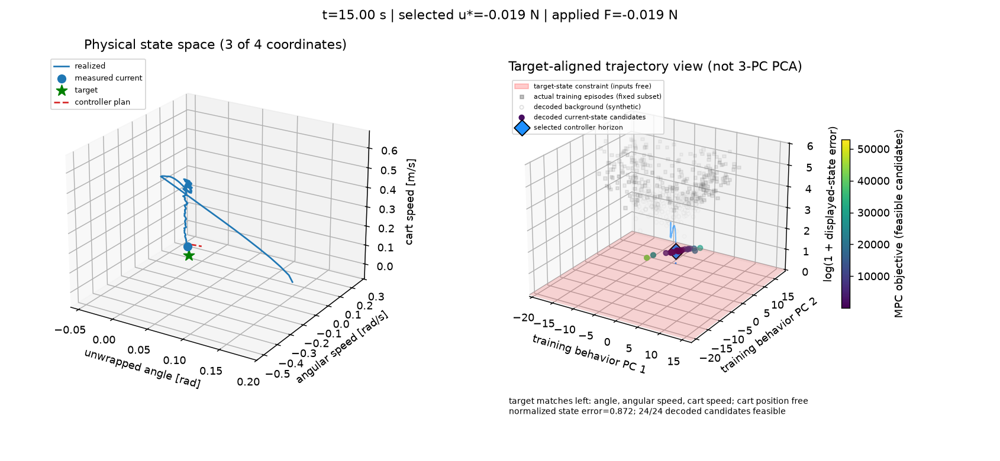
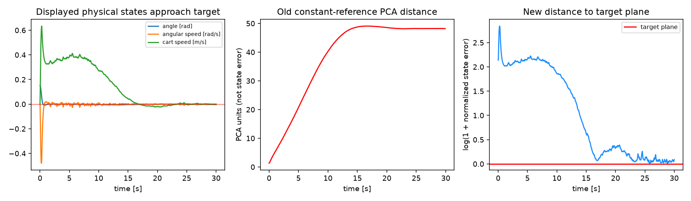
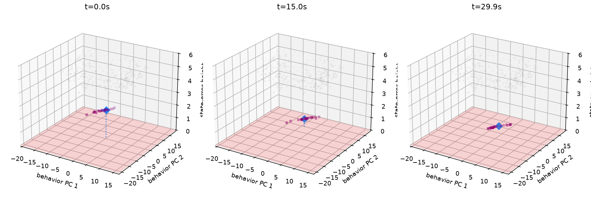

# What the right plot shows

The previous right plot was misleading for judging convergence. Its red star
specified a **whole zero-state, zero-input horizon**, including zero cart
position. The left green star only specifies **angle = angular speed = cart
speed = 0**. The cart actually finishes at **4.40 m**, although those three
shown coordinates approach zero. Further, distances in a three-dimensional
PCA projection are not distances to the state target.

The revised view uses a red **target-state constraint plane**, actual training
records, and separately labelled decoded samples. Earlier renderers, source
functions, and GIFs remain available.



## Every element and its computation

State order in stored/model arrays is `[position, cart_speed, angle,
angular_speed]`. State velocities are converted to SI with the recorded
`state_scale_to_SI`; force uses `force_scale_to_N`.

| Element | Data and computation | What it establishes |
|---|---|---|
| Left blue curve and dot | Actual simulated states, shown as SI `[angle, angular_speed, cart_speed]` | Realized physical motion; not decoder predictions |
| Left green star | The same three coordinates of the controller's zero state reference | Displayed state target; cart position is hidden |
| Left dashed red curve | State sequence from the controller's actual selected horizon at this step | Learned forecast, not a future plant measurement |
| Right blue diamond and blue history | Actual selected **complete horizon**, transformed by the mapping below; blue X if decoder feasibility fails | Selected plan and earlier selections; not a training record |
| Right colored circles | 24 newly decoded horizons per cached frame, starting at the measured state and using independently sampled bounded future inputs | A sample of the current-state decoded slice; **not training data and not the optimizer population** |
| Color bar | Existing tracking/input/terminal/input-smoothness MPC objective evaluated on those decoded horizons; one fixed color range for the whole movie | Lower cost under the learned objective; no promise of plant success |
| Hollow gray circles | The original 256 fixed, newly decoded background horizons: initial state sampled from the visualization box and each future input sampled in `[-10,10]` | Synthetic decoder output; **not training data** |
| Filled gray squares | 256 original measured training episodes, sampled without replacement from the training split | Actual records used to train the transition model; no decoder substitution |
| Red translucent plane | Zero displayed-state error of the **first state** of a horizon; future inputs and cart position unrestricted | Same displayed target as the left star; not a claim that arbitrary inputs maintain that state |
| Blue dotted segment | Vertical segment from selected diamond to the target plane | Displayed-state error height, not a PCA/geodesic distance |
| Orange X, when present | Decoded samples failing initial-state agreement or input bounds | Failed decoder feasibility check, not a plant-dynamics check |

The canonical objective remains unchanged: model-unit state weights
`diag(.02,30,100,10)`, input weight `.03`, terminal multiplier `12`, and input
increment weight `.002`. Cart position is penalized by the controller even
though it is omitted from the left plot and plane criterion.

## Why the old background looks concentrated near the start

Old visualization features were the 154-dimensional vector
`w = [vec(x[0:31]), vec(u[0:30])]`, with states first. Each feature was centered
and scaled using **only the 256 synthetic background horizons**; PCA was then
fitted to that standardized background, retaining three components (73.0% of
its variance). The same fixed map was used for every frame.

The background's initial-state box in model units was
`position ±0.5, cart_speed ±0.8, angle ±0.6, angular_speed ±1`.
It stays fixed while the selected trajectory's cart position leaves that box
and reaches 4.40 m. The gray cloud is not one point: its three old PCA ranges
span **37.30, 33.45, and 15.49** units. But the selected point's distance from
the background center grows from **1.80 to 48.33**; fixed limits spanning that
excursion make the gray cloud look compressed near the start. The constant
zero-horizon red star stays there too. None of this demonstrates training-set
coverage, because the old cloud was never the training set.



## How the target plane is made exact

A generic PCA of entire horizons cannot guarantee that a particular state
constraint becomes a plane. In the original 154-dimensional ambient behavior
space, fixing the three displayed coordinates of `x0` gives an affine set with
151 free coordinates, before dynamics are enforced. Its three-PC image need
not be a two-dimensional plane; its intersection with decoder-feasible
behaviors need not be flat.

The corrected view **explicitly changes the display coordinates**:

```text
r(w) = norm(([angle0, angular_speed0, cart_speed0] - left_target)
            / [0.02 rad, 0.05 rad/s, 0.05 m/s])
view(w) = [training_behavior_PC1(w), training_behavior_PC2(w), log(1 + r(w))]
```

Horizontal PCs use full-horizon state/input features, standardized and fitted
once on **all 2,450 training episodes**, never on validation/test episodes.
The vertical coordinate is an explicit state-error feature, not a third PC.
The log scale keeps the broad training cloud and small near-target errors
visible together. The red plane is `height = 0`, which holds **if and only if**
the three initial coordinates equal the left target, regardless of future input
or cart position. In particular it includes the controller's full zero target.

Thus the blue diamond approaches the plane as the *displayed measured state*
approaches the left target. It need not decrease monotonically: this controller
has transients and residual oscillations. In this run, error `r` falls from
**7.5 to 0.0933**, giving height **2.140 to 0.0892**. The final three SI values
are `[-0.000297 rad, -0.00460 rad/s, 0.000104 m/s]`.



The plane is a target-constraint visualization, **not** an equilibrium manifold,
a terminal-state condition, a guarantee of future tracking, or a surface of
training trajectories. All candidates sharing the same initial state have the
same height, although their horizontal locations and costs differ. Horizontal
proximity to gray training squares still does not prove proximity in the full
154-dimensional behavior space. Full-state convergence is still false because
cart position does not return to zero. No controller or training change was
made to improve the picture.

## Provenance and reproduction

The dataset is the checkpoint's companion
`saves/validation/models/reconstructed-seed0/data.npz` (3,500 episodes).
The original `split_episodes` seed-0 permutation assigns 525 test, 525 validation,
and 2,450 training episodes. The display chooses 256 of those training episodes
with seed234; original dataset row IDs, hashes, formulas, and measured values
are in [audit.json](target-plane/audit.json). The transition model was trained
on transitions extracted from those measured episodes, not by fitting the
entire displayed horizon as a single training example.

```bash
python -m scripts.explain_trajectory_visualization \
  --source saves/visualizations/trajectory_manifold_convergence \
  --dataset saves/validation/models/reconstructed-seed0/data.npz \
  --output saves/visualizations/trajectory_manifold_convergence_plane
```

Source functions: `TargetAlignedProjection`, `target_plane_view`, and
`TargetPlaneVisualization` in `src/trajectory_target_visualization.py`;
`prepare`/`figures`/CLI in `scripts/explain_trajectory_visualization.py`.
Existing functions in `src/trajectory_visualization.py` and
`scripts/visualize_trajectory_manifold.py` remain unchanged.
The command regenerates the figures/audit, saves the fixed training projection
and episode IDs to `target_view.npz`, copies the unchanged closed-loop arrays,
and renders the full GIF. `--skip-animation` regenerates only the report and
cached/static outputs. All old GIF directories are preserved.
